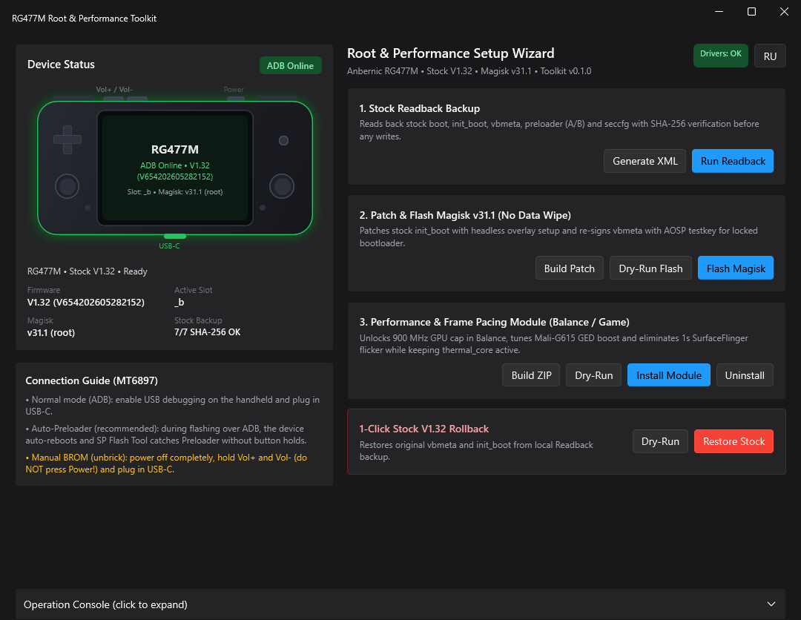
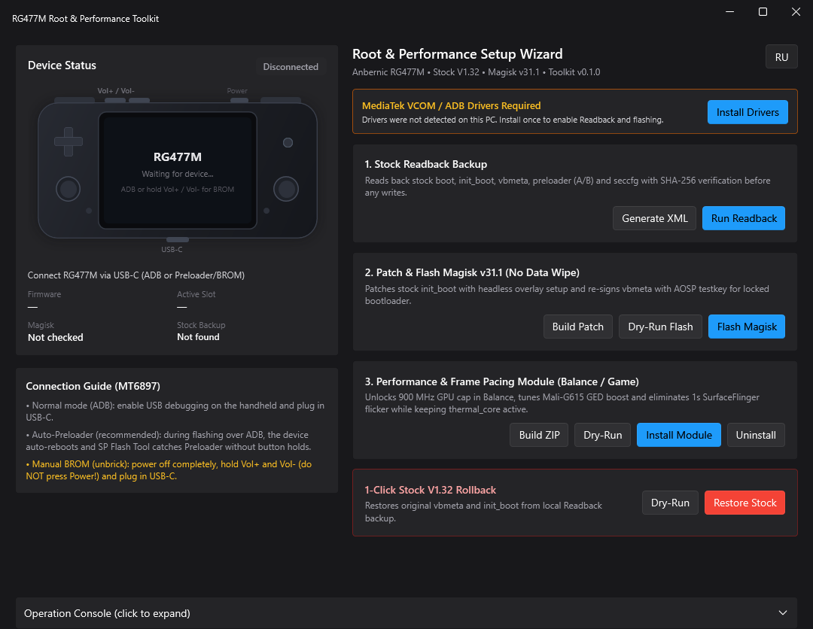
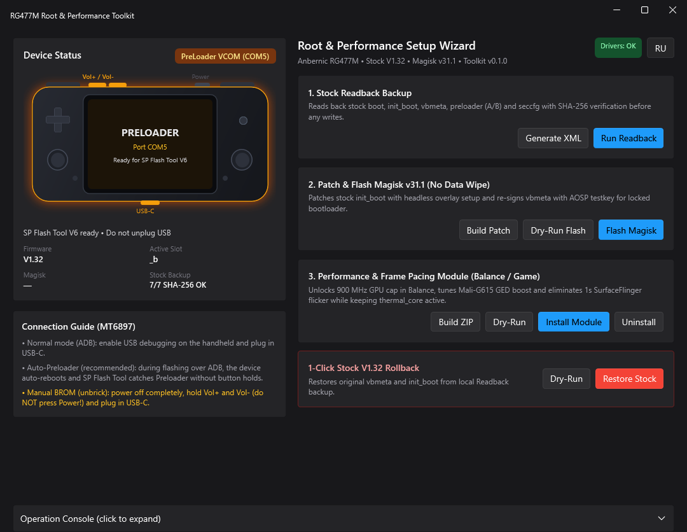
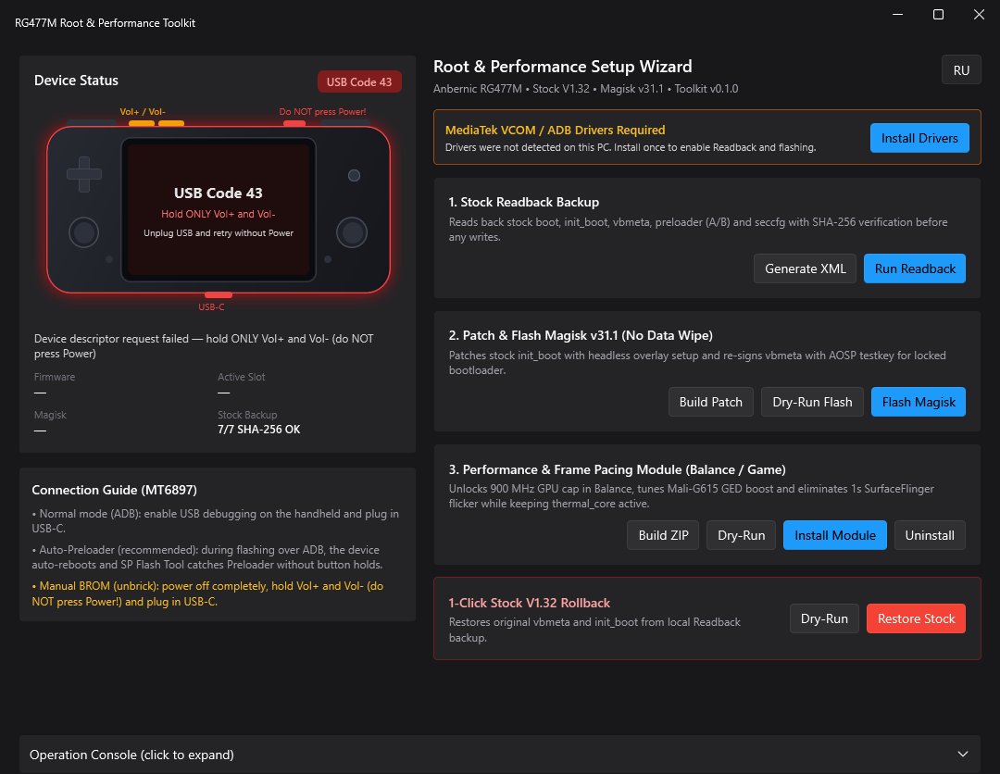
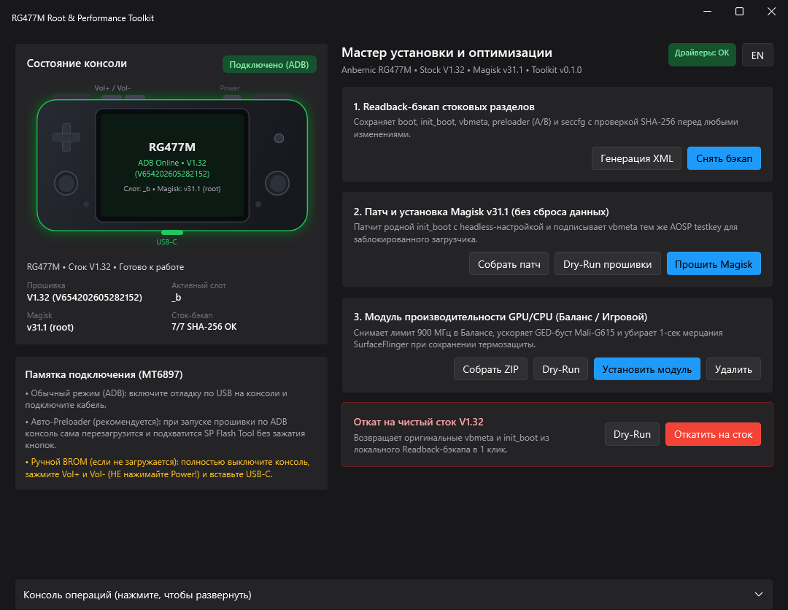
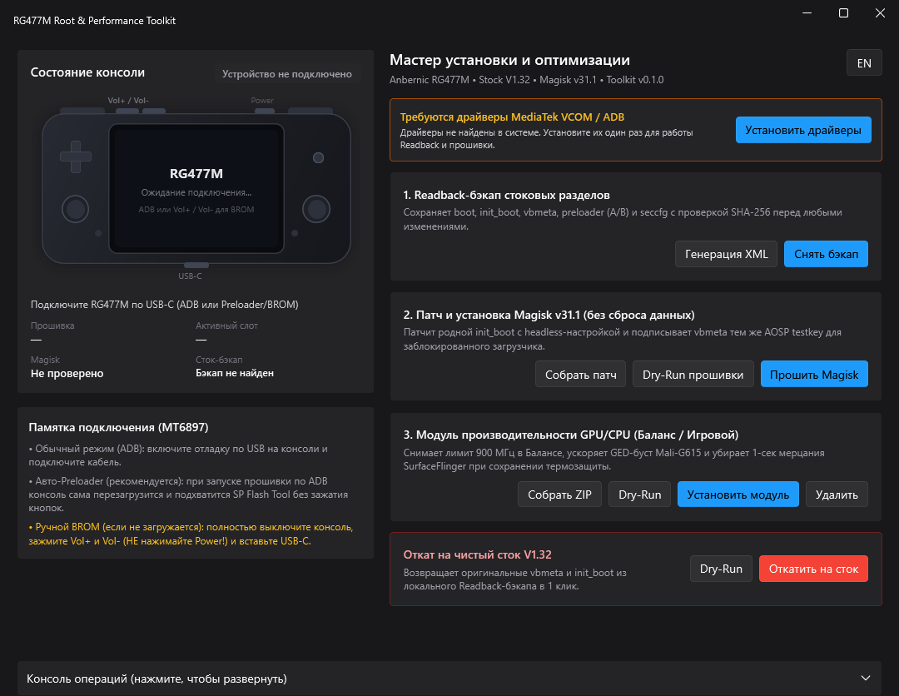
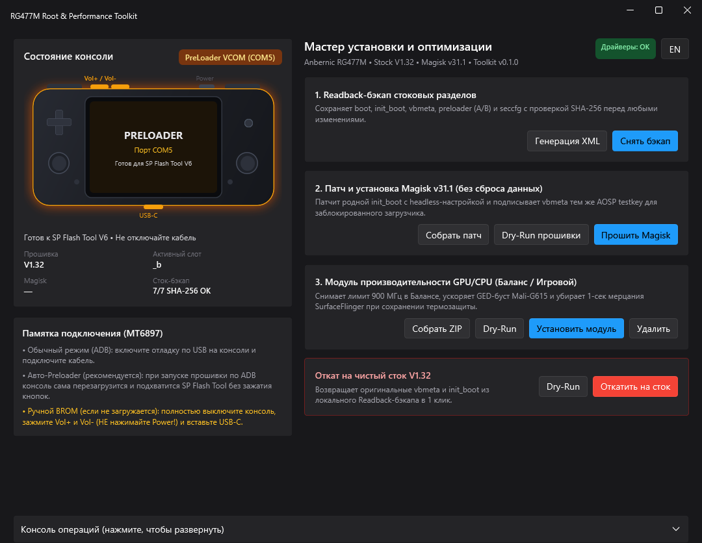
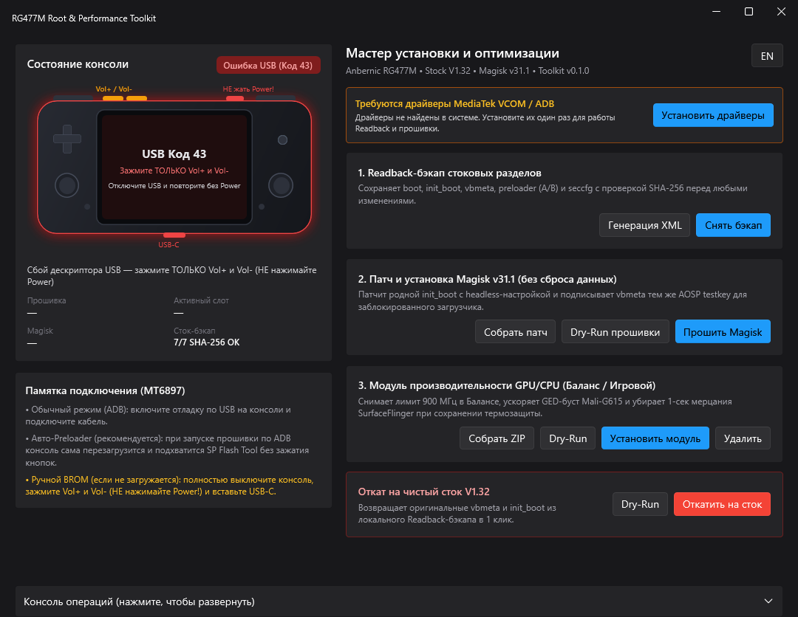

# RG477M Root & Performance Toolkit

> **Anbernic RG477M (MT6897 / Dimensity 8300 · Stock V1.32)** · [Русская версия ниже](#rg477m-root--performance-toolkit-ru)

An all-in-one Windows desktop app (**`RG477MToolkit.exe`**) and Magisk module (**`rg477m_perf_tuning`**) for safe, zero-wipe root (**Magisk v31.1**), smooth 60 FPS gaming in everyday modes, and quiet cooling on Stock **V1.32** — with 1-click rollback.

### Why this Windows App?
Rooting a locked-bootloader MediaTek handheld normally requires hunting down drivers, scatter XMLs, SP Flash Tool configs, AVB signing scripts, and manual BROM button combos. **`RG477MToolkit.exe`** wraps the entire workflow into one clean Fluent UI:
- **Works out of the box:** Release ZIP bundles `ADB`, `SP Flash Tool V6`, RG477M Download Agent, `Magisk v31.1`, and the MediaTek driver installer — with automatic driver detection on startup.
- **Safe & automated:** Enforces model/firmware checks (`RG477M`, `V1.32`), auto-detects active A/B slot (`128/256 GB`), backs up stock partitions with SHA-256 before any write, catches `PreLoader VCOM` automatically on reboot, and restores stock in one click.

### What the Module Fixes & What You Get
- **Full 60 FPS in Balance mode:** Removes the stock `900 MHz` Mali-G615 GPU cap and slow scaling (~33% lower GPU frame times in heavy 3D tests), while keeping idle clocks low (`265 MHz` GPU / `400 MHz` CPU).
- **Less heat in Game mode:** Replaces stock CPU `performance` lock with fast `schedutil` + `uclamp` tuning.
- **Quiet, smooth fan:** Replaces erratic stock `bal` and `turbo` fan curves ("fan hunting") with ~10s EMA-smoothed temperature tracking and gentle speed ramps (silent when cool or screen-off; `silent`/`fixed` modes stay untouched).
- **Cleaner frame pacing & full safety:** Fixes stock `debug.sf.disable_backpressure=1` (eliminating ~1s display flickers), keeps `thermal_core` active at all times, backs off above `85 °C`, and auto-disables on 2 failed boots.

### Screenshots
<table>
  <tr>
    <td align="center"> <b>ADB Online &amp; Drivers OK</b></td>
    <td align="center"> <b>Disconnected + Driver Prompt</b></td>
  </tr>
  <tr>
    <td align="center"> <b>PreLoader VCOM (Auto-Catch)</b></td>
    <td align="center"> <b>USB Code 43 Recovery Hint</b></td>
  </tr>
</table>

### Quick Start (3 Steps)
1. Download and extract **`RG477MToolkit.zip`** from **Releases**, then run **`launch-ui.bat`** (or `RG477MToolkit.exe`). If prompted, click **Install Drivers**.
2. Enable **USB Debugging** on RG477M, plug in USB-C, and run **Step 1 (Readback Backup)** → **Step 2 (Build Patch & Flash Magisk)**.
3. After reboot, click **Step 3 (Install Module)** and reboot once more.

### Detailed Guides
- <a href="Guides/en/QUICKSTART.md" target="_blank" rel="noopener noreferrer">Full Setup, BROM & Rollback Guide (EN)</a>
- <a href="Guides/en/MODULE.md" target="_blank" rel="noopener noreferrer">Performance Module & Fan Curves Deep-Dive (EN)</a>

Credits & upstream licences: [THANKS.md](THANKS.md) · Licensed under [MIT](LICENSE).

---

# RG477M Root & Performance Toolkit (RU)

> **Anbernic RG477M (MT6897 / Dimensity 8300 · Сток V1.32)**

Единая Windows-программа (**`RG477MToolkit.exe`**) и Magisk-модуль (**`rg477m_perf_tuning`**) для безопасной установки root (**Magisk v31.1**) без сброса данных, стабильных 60 FPS в обычных режимах и тихой плавной работы вентилятора на стоке **V1.32** — с откатом в 1 клик.

### Зачем нужна сама программа?
Обычно рут на MediaTek с заблокированным загрузчиком требует ручной возни с драйверами, scatter-файлами, SP Flash Tool, подписью AVB `vbmeta` и комбинациями кнопок BROM. **`RG477MToolkit.exe`** делает всё в одном понятном окне (RU / EN):
- **Готово из коробки:** релизный архив уже включает `ADB`, `SP Flash Tool V6`, DA-агент RG477M, `Magisk v31.1` и установщик драйверов MediaTek, а программа при запуске сама проверяет, установлены ли драйверы.
- **Безопасно и автоматически:** проверяет модель и прошивку (`RG477M`, `V1.32`), сама определяет активный слот (`_a`/`_b`) и объём памяти (`128/256 GB`), снимает полный бэкап стока с SHA-256, сама подхватывает `PreLoader` при перезагрузке (без зажатия кнопок) и откатывает сток в 1 клик.

### Что исправляет модуль и что вы получите
- **Ровные 60 FPS даже в «Балансе»:** снимает стоковый потолок `900 МГц` на GPU Mali-G615 и ускоряет отклик (время кадра GPU ниже примерно на треть в тяжёлом 3D), при этом в меню и простое частоты спокойно падают до минимума (`265 МГц` GPU / `400 МГц` CPU).
- **Меньше нагрева в режиме `Game`:** заменяет стоковый лок CPU `performance` на быстрый `schedutil` + `uclamp`.
- **Тихий и плавный вентилятор:** убирает «шторм» и плавающие обороты в режимах `bal` и `turbo` за счёт ~10-секундного сглаживания температуры и плавного шага PWM (тишина в простое и со спящим экраном; режимы `silent` и `fixed` остаются за шторкой).
- **Плавность кадров и защита:** исправляет стоковый флаг `debug.sf.disable_backpressure=1` (убирает ~1-сек. мерцания), оставляет штатную термозащиту `thermal_core` включённой, приглушает буст выше `85 °C` и сам отключается при 2 неудачных загрузках.

### Скриншоты приложения
<table>
  <tr>
    <td align="center"> <b>Подключено (ADB) и драйверы OK</b></td>
    <td align="center"> <b>Ожидание и баннер драйверов</b></td>
  </tr>
  <tr>
    <td align="center"> <b>PreLoader VCOM (автоподхват)</b></td>
    <td align="center"> <b>Подсказка при ошибке USB Код 43</b></td>
  </tr>
</table>

### Быстрый старт (3 шага)
1. Скачайте и распакуйте **`RG477MToolkit.zip`** из раздела **Releases**, запустите **`launch-ui.bat`** (или `RG477MToolkit.exe`). Если появится жёлтый баннер — нажмите **Установить драйверы**.
2. Включите **Отладку по USB** на RG477M, подключите кабель USB-C и выполните **Шаг 1 (Снять бэкап)** → **Шаг 2 (Собрать патч → Прошить Magisk)**.
3. После загрузки нажмите **Шаг 3 (Установить модуль)** и перезагрузите консоль.

### Расширенные руководства
- <a href="Guides/ru/QUICKSTART.md" target="_blank" rel="noopener noreferrer">Подробная инструкция по установке, BROM и откату (RU)</a>
- <a href="Guides/ru/MODULE.md" target="_blank" rel="noopener noreferrer">Подробно о модуле производительности и кривых вентилятора (RU)</a>

Благодарности и лицензии компонентов: [THANKS.md](THANKS.md) · Лицензия: [MIT](LICENSE).
